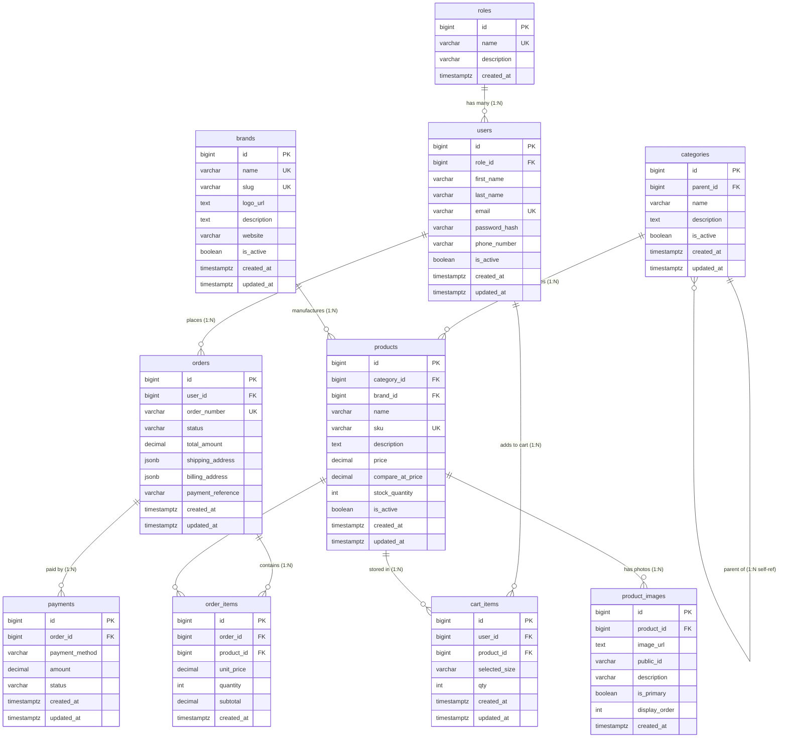

# 🛒 E-Commerce T-Shirt & Apparel Atelier - Project Architecture & Technical Summary

> **Academic Project:** SETEC Institute — Year 4, Semester 1 Final Project  
> **Domain:** T-Shirt & Streetwear Atelier E-Commerce Platform  
> **Backend Architecture:** Laravel 13 (PHP 8.3+) & PostgreSQL (`pgsql`)  
> **Frontend Architecture:** Angular 19+ with 3D Streetwear Showcase  
> **Last Updated:** November 2026  

---

## 📌 1. Project Overview

This project is a full-stack, enterprise-grade e-commerce application developed for a contemporary streetwear atelier specializing in 320GSM custom combed ring-spun cotton graphic T-shirts. The backend provides:
- PostgreSQL-native relational integrity and check constraints.
- Complete **Laravel Resource Controllers** supporting both API JSON responses and Blade views.
- Custom authentication handling with hashed credentials and role-based permissions.
- Modular **Middleware layer** guarding admin endpoints, role checks, and active account enforcement.
- Integrated file-upload pipeline storing product photos and brand logos directly to public assets.
- Dual-mode routing (`routes/api.php` and `routes/web.php`) serving the Angular frontend and traditional web views.

---

## 🛠️ 2. Technology Stack & Environment

| Component | Technology | Description |
|:---|:---|:---|
| **Backend Framework** | **Laravel 13** | Eloquent ORM, Resource Controllers, and Pipeline Middleware |
| **Runtime** | **PHP 8.3+** | High-performance PHP runtime with OpenSSL & PDO-PgSQL |
| **Database** | **PostgreSQL 16** | ACID-compliant relational database on port `5432` |
| **Timestamps** | **TIMESTAMPTZ** | Full timezone-aware timestamps via `$table->timestampsTz()` |
| **Data Types** | **JSONB & Numeric** | Native JSONB for addresses, precise `DECIMAL(12,2)` for monetary values |
| **Asset Storage** | **Public Image Folders** | Direct storage in `public/images/products/` and `public/images/brands/` |
| **Frontend** | **Angular 19+** | 3D Streetwear Showcase carousel, cart state, and checkout flows |

### Environment Configuration (`.env`)
```dotenv
APP_NAME="Streetwear E-Commerce"
APP_ENV=local
APP_KEY=base64:...
APP_DEBUG=true
APP_URL=http://localhost:8000

DB_CONNECTION=pgsql
DB_HOST=127.0.0.1
DB_PORT=5432
DB_DATABASE=laravel_final
DB_USERNAME=postgres
DB_PASSWORD=1
```

---

## 🗄️ 3. Database Architecture (10 Tables)

The database enforces relational integrity across **10 core tables** with PostgreSQL-native `CHECK` constraints and strict foreign keys:



---

## 📁 4. Directory Structure

```text
Backend/ecommerce_website/
├── app/
│   ├── Http/
│   │   ├── Controllers/
│   │   │   ├── AuthController.php        # Register, Login, Logout, Profile
│   │   │   ├── BrandController.php       # Full Resource CRUD + Search + Logo upload
│   │   │   ├── CategoryController.php    # Full Resource CRUD
│   │   │   ├── OrderController.php       # Full Resource CRUD + Checkout
│   │   │   ├── ProductController.php     # Full Resource CRUD + Search + Photo upload
│   │   │   ├── ReviewController.php      # Verified customer reviews
│   │   │   └── UserController.php        # Full Resource CRUD + Search
│   │   └── Middleware/
│   │       ├── AdminMiddleware.php       # Guard for admin role (403 Forbidden)
│   │       ├── ApiAuthMiddleware.php     # Guard for API authentication (401 Unauthorized)
│   │       ├── CheckActiveUser.php       # Blocks deactivated accounts
│   │       └── RoleMiddleware.php        # Multi-role checker (role:admin,customer)
│   └── Models/
│       ├── Brand.php                     # Auto-slug, products count, scopes
│       ├── Category.php                  # Hierarchy, parent/children, item_count
│       ├── Order.php                     # JSONB casts, user/items/payments
│       ├── OrderItem.php                 # Relational subtotal & unit_price
│       ├── Payment.php                   # ABA_PAY, cards, statuses
│       ├── Product.php                   # Sizes, image_url, gallery, rating
│       ├── ProductImage.php              # Primary image flags & display order
│       ├── Role.php                      # Admin & Customer role definitions
│       └── User.php                      # Custom password_hash mutator & Auth
├── bootstrap/
│   └── app.php                           # Route registrations & Middleware aliases
├── database/
│   ├── factories/
│   │   ├── BrandFactory.php              # Factory for Brands
│   │   ├── CartItemFactory.php           # Factory for Cart Items
│   │   └── UserFactory.php               # Factory for Users
│   ├── migrations/                       # 13 migrations in strict dependency order
│   └── seeders/
│       └── DatabaseSeeder.php            # Consolidated Master Seeder (all 10 tables in 1 single file)
├── public/
│   └── images/
│       ├── brands/                       # Brand logo uploads
│       └── products/                     # Product photo uploads
├── resources/
│   └── views/
│       └── products/
│           ├── create.blade.php          # Form with enctype="multipart/form-data"
│           └── index.blade.php           # Inventory list displaying uploaded photos
└── routes/
    ├── api.php                           # API routes with middleware protection
    └── web.php                           # Web routes with Blade views
```

---

## 🎯 5. Controllers Architecture (Resource Pattern)

All controllers strictly follow the **Laravel Resource Controller** academic pattern taught at SETEC (`index`, `create`, `store`, `show`, `edit`, `update`, `destroy`, plus custom `search`).

### Dual-Response Design
Every method automatically detects the requester:
- If called by Angular (`$request->wantsJson() || $request->is('api/*')`), it returns a structured JSON payload:
  ```json
  { "success": true, "count": 7, "data": [ ... ] }
  ```
- If visited via a standard web browser, it renders the corresponding Blade view (`view('products.index', ...)`).

### Summary of Controllers

| Controller | Methods Implemented | Special Features |
|:---|:---|:---|
| **`ProductController`** | `index`, `create`, `store`, `show`, `edit`, `update`, `destroy`, `search`, `featured` | Handles file uploads (`photo`/`image`), auto-creates primary `product_images` row, searches across name/sku/category |
| **`BrandController`** | `index`, `create`, `store`, `show`, `edit`, `update`, `destroy`, `search` | Auto-slug generation, logo upload to `public/images/brands/`, product counts |
| **`CategoryController`** | `index`, `create`, `store`, `show`, `edit`, `update`, `destroy` | Recursive hierarchy support (`parent_id`), product counter |
| **`UserController`** | `index`, `create`, `store`, `show`, `edit`, `update`, `destroy`, `search` | Role filtering, password hashing via `Hash::make()`, order history |
| **`OrderController`** | `index`, `create`, `store`, `show`, `edit`, `update`, `destroy` | Multi-item checkout transaction, JSONB shipping addresses, payment record generation |
| **`CartController`** | `index`, `create`, `store`, `show`, `edit`, `update`, `destroy`, `clear` | Automatic line subtotal calculation, quantity increment on same product/size, clear cart |
| **`AuthController`** | `register`, `login`, `logout`, `me` | Authenticates against `password_hash`, checks `is_active`, issues profile payload |
| **`ReviewController`** | `index` | Serves verified buyer ratings and testimonials for the frontend |

---

## 🛡️ 6. Middleware Layer

The middleware pipeline is registered in [`bootstrap/app.php`](file:///e:/Setec%20Y4%202026/Semester1%20Y4/Sermerster1%20Y4/Laravel/FinalProject/Backend/ecommerce_website/bootstrap/app.php) with the following aliases:

```php
->withMiddleware(function (Middleware $middleware): void {
    $middleware->alias([
        'admin'        => \App\Http\Middleware\AdminMiddleware::class,
        'role'         => \App\Http\Middleware\RoleMiddleware::class,
        'check.active' => \App\Http\Middleware\CheckActiveUser::class,
        'auth.api'     => \App\Http\Middleware\ApiAuthMiddleware::class,
    ]);
})
```

- **`admin`**: Checks if the user's role is `admin`. Rejects non-admins with HTTP 403.
- **`role:...`**: Accepts arguments (e.g. `role:admin,manager`) for flexible role checking.
- **`check.active`**: Ensures `user->is_active === true`. Logs out and blocks deactivated accounts.
- **`auth.api`**: Validates API authentication (Bearer tokens, session, or `X-User-Id` header).

---

## 🖼️ 7. Image Storage & Photo Upload Pipeline

### Upload Destinations
1. **`public/images/products/`**: Directly accessible from the web at `http://localhost:8000/images/products/{filename}` without requiring storage symlinks.
2. **`public/images/brands/`**: Stored logos for apparel brands.
3. **`storage/app/public/products/`**: Standard storage disk location.

### How Product Photo Upload Works
When creating or updating a product:
1. Form sends `multipart/form-data` with `photo` or `image`.
2. Controller validates image format (`jpeg, png, jpg, webp, svg` up to 5MB).
3. File is named with a unique timestamp: `time() . '_' . Str::slug(...) . '.' . extension`.
4. Stored directly to `public/images/products/`.
5. An entry is created in `product_images`:
   ```php
   $product->images()->create([
       'image_url'     => '/images/products/' . $filename,
       'public_id'     => 'products/' . $filename,
       'description'   => $product->name . ' Primary Photo',
       'is_primary'    => true,
       'display_order' => 1,
   ]);
   ```

---

## 🌐 8. Complete Route Map (79 Routes)

### API Routes (`routes/api.php`)
```php
// Authentication
POST      /api/auth/register
POST      /api/auth/login
POST      /api/auth/logout        (middleware: auth.api)
GET       /api/auth/me            (middleware: auth.api)

// Search & Featured Catalog
GET       /api/products/search
GET       /api/products/featured
GET       /api/brands/search
GET       /api/users/search

// Public Resources
GET|POST|PUT|DELETE   /api/products
GET|POST|PUT|DELETE   /api/categories
GET|POST|PUT|DELETE   /api/brands
GET|POST|PUT|DELETE   /api/orders

// Cart Items Management
DELETE                /api/cart/clear
GET|POST|PUT|DELETE   /api/cart

// Admin Protected Resources
GET|POST|PUT|DELETE   /api/users          (middleware: auth.api, admin)

// Testimonials
GET       /api/reviews
```

### Web Routes (`routes/web.php`)
```php
// Authentication
POST      /register
POST      /login
POST      /logout

// Resource CRUD with Blade Views
GET|POST|PUT|DELETE   /products           (create: products.create, index: products.index)
GET|POST|PUT|DELETE   /categories
GET|POST|PUT|DELETE   /brands
GET|POST|PUT|DELETE   /orders

// Admin Protected Web
GET|POST|PUT|DELETE   /users              (middleware: admin)
```

---

## 🎨 9. Frontend 3D Streetwear Showcase Integration

The Angular frontend at `../../Frontend/ecommerce_website` interfaces directly with this backend:
- **3D Arc Carousel:** Pulls 320GSM drops dynamically from `GET http://localhost:8000/api/products`.
- **Pure Silhouettes:** Rectangular frames removed to display clean floating T-shirt silhouettes with drop badges.
- **Natural Web Scrolling:** Removed mouse wheel hijacking (`preventDefault`), allowing the user to scroll through the page freely.
- **Navigation Controls:** Left/Right keyboard arrow navigation and prominent circular glowing buttons.
- **Cart & Reviews:** Integrated with `/api/reviews` and `/api/orders`.

---

## ⚡ 10. Quick Start Commands

```bash
# 1. Run migrations and seed clean data
php artisan migrate:fresh --seed

# 2. Check route list
php artisan route:list

# 3. Start the Laravel backend server
php artisan serve
# Running at: http://localhost:8000

# 4. Start the Angular frontend
cd ../../Frontend/ecommerce_website
ng serve
# Running at: http://localhost:4200
```
